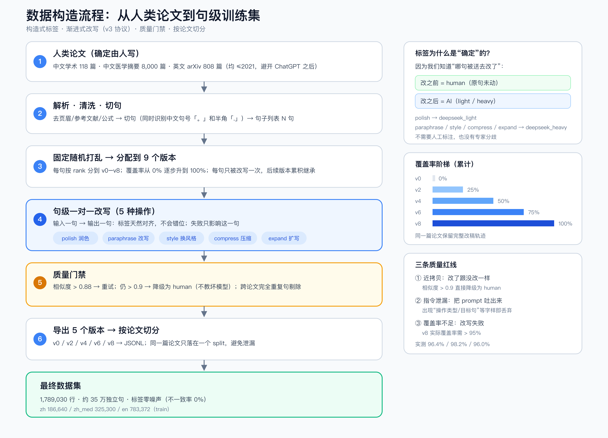

# AI Writing Detector（Laya）

> 给一篇文章，逐句告诉你：**哪句话像 AI 写的**。
>
> 不是给整篇打一个分，而是定位到句子和连续段落，方便作者针对性修改。

- 模型：**Laya**（421M 多语决策模型）微调
- 数据：人类论文 vs DeepSeek 润色/改写，**构造式标签**（不需要人工标注）
- 效果：中文学术 **TPR@1%FPR = 0.895**（每 100 句人类文本只误报 1 句时，能抓到 89.5% 的 AI 句）

**开源地址**

| 资产 | 地址 |
|---|---|
| 模型 | https://huggingface.co/johnson/AI-writing-detector-laya-zh |
| 数据集 | https://huggingface.co/datasets/johnson/AI-writing-detector-dataset |
| 代码 | https://github.com/johnson7788/checkAI |

**国内镜像（ModelScope）**

| 资产 | 地址 |
|---|---|
| 模型 | https://www.modelscope.cn/models/InfoxmedModel/AI-writing-detector-laya-zh |
| 数据集 | https://www.modelscope.cn/datasets/InfoxmedModel/AI-writing-detector-dataset |


---

## 目录

1. [为什么需要这个项目](#1-为什么需要这个项目)
2. [核心思路：为什么用“构造数据”而不是人工标注](#2-核心思路为什么用构造数据而不是人工标注)
3. [数据是怎么造出来的](#3-数据是怎么造出来的)
4. [数据质量怎么保证](#4-数据质量怎么保证)
5. [为什么选 Laya，而不是 GPT / BERT](#5-为什么选-laya而不是-gpt--bert)
6. [模型是怎么训练的](#6-模型是怎么训练的)
7. [怎么评测：TPR@1%FPR 是什么](#7-怎么评测tpr1fpr-是什么)
8. [怎么使用](#8-怎么使用)
9. [完整复现步骤](#9-完整复现步骤)
10. [常见问题 FAQ](#10-常见问题-faq)
11. [局限与伦理](#11-局限与伦理)
12. [仓库结构、许可、引用](#12-仓库结构许可引用)

---

## 1. 为什么需要这个项目

### 1.1 真实场景

一篇论文投出去之前，作者常常想知道：

- 我这段结论是不是太像 ChatGPT 写的？
- 审稿人会不会觉得这段是 AI 润色的？
- 如果学校要求“AI 率低于 20%”，我到底是哪几句超了？

现有工具大多只给一个**整篇分数**（比如“AI 率 37%”）。这个数字有两个问题：

1. **不可行动**：作者不知道该改哪里；
2. **不可解释**：37% 是怎么算的？哪几句贡献最大？

所以我们做的是**句级检测**：

```
第 12 句  p_ai=0.97   ← 高度疑似 AI 改写
第 13 句  p_ai=0.95
第 14 句  p_ai=0.91
...
整篇 AI 句占比：21.4%
连续区间：[12-14] p=0.94
```

作者可以直接跳到第 12–14 句去改。

### 1.2 为什么这件事很难

“AI 写的”没有一个客观标准。同样一句话，可能是：

- 人写的；
- 人写完，AI 润色了标点和连接词；
- AI 重写了一遍；
- AI 写完，人又改了两句。

这四种情况在字面上可能只差几个词。**通用大模型（GPT）直接判断，效果很差**——我们在第 5 节会用实测数据说明。

所以这个项目的核心不是“找个更大的模型”，而是：

> **先把“哪句是 AI 改的”变成确定的事实，再让模型去学。**

这就是“构造式标签”。

---

## 2. 核心思路：为什么用“构造数据”而不是人工标注

### 2.1 人工标注的问题

要训练一个句级分类器，最直接的做法是：

1. 找 1 万句话；
2. 请专家标“人写 / AI 写”；
3. 训练模型。

问题是：

- **贵**：句级标注比文档级贵得多；
- **慢**：1 万句要标很久；
- **不一致**：同一句话，不同专家意见不同；
- **边界模糊**：AI 只改了半句怎么办？

### 2.2 构造式标签：让“改”这个动作自己产生标签

换个思路：

1. 拿一篇**确定是人写**的论文（比如 2019 年发表的中文期刊论文）；
2. 让 AI 去改其中一部分句子；
3. **改之前的句子 = human，改之后的句子 = AI**。

因为我们知道“哪句被送去改了”，所以标签是**100% 确定**的，不需要任何人判断。

这就像做化学实验：

- 人工标注 = 给别人一杯液体，问“这是什么”；
- 构造数据 = 自己往杯子里加试剂，**你知道加了什么**。

### 2.3 三种标签

| 标签 | 含义 | 怎么产生 |
|---|---|---|
| `human` | 人写的 | 原句没动 |
| `deepseek_light` | AI 轻度润色 | 只改语法、连接词、标点 |
| `deepseek_heavy` | AI 改写 | 重写、压缩、扩写、换风格 |

推理时：

```
p_ai = p_light + p_heavy
```

`p_ai` 越高，越像 AI。

---

## 3. 数据是怎么造出来的



> 一张图看懂：人类论文 → 切句 → 9 个版本 → 句级改写 → 质量门禁 → 按论文切分。
> 可编辑源文件：[docs/flow.svg](docs/flow.svg)

### 3.1 人类文本从哪来

| 子集 | 来源 | 数量 |
|---|---|---|
| `zh` | 中文期刊论文（计算机类） | 118 篇 |
| `zh_med` | 中文医学论文摘要 | 8,000 篇 |
| `en` | arXiv 论文（2007–2017） | 808 篇 |

> 为什么强调 2017 年以前？因为 ChatGPT 是 2022 年底发布的，之后的文本本身可能带 AI 痕迹，不能当“纯人类”种子。

### 3.2 第一步：切句

一篇论文先被切成句子。中文有个坑：

- 期刊 PDF 里大量使用**半角句号 `.`**，而不是 `。`；
- 如果只认 `。`，整段会被当成一句（我们早期就踩过这个坑，最长“句子”有 2,024 字）。

所以切句器要同时认：

```
。！？；… 以及 汉字后面的 .
```

### 3.3 第二步：渐进式改写（v3 协议）

这是整个项目最核心的设计。

不是“随机改 30% 的句子”，而是让 AI **一轮一轮地改**，形成 9 个版本：

```
v0  (0%)    原始论文
v1  (15%)   polish      润色 15% 的句子
v2  (25%)   paraphrase  再改写 10%
v3  (40%)   style       再换风格 15%
v4  (50%)   compress    再压缩 10%
v5  (60%)   expand      再扩写 10%
v6  (75%)   style       再换风格 15%
v7  (90%)   paraphrase  再改写 15%
v8  (100%)  polish      最后润色 10%
```

关键点：

1. **每句只改一次**，改完就固定；
2. **后面的版本继承前面的修改**，模拟真实改稿过程；
3. 每一版都知道“哪些句子已经被改过”。

这样一条数据就同时包含：

- 句子文本；
- 标签（human / light / heavy）；
- 编辑操作（polish / paraphrase / ...）；
- 当前文档的 AI 覆盖率（0 / 25% / 50% / 75% / 100%）。

### 3.4 第三步：句级一对一改写

我们不整段扔给 AI，而是**一次只改一句**：

```
输入：此外，本文提出的方法具有较高的准确率。
操作：paraphrase
输出：同时，所提方法在精度方面表现更优。
```

为什么？

- 输入一句、输出一句 → **标签天然对齐**，不会出现“改完以后句子错位”；
- 可以精确控制长度（压缩到 60–80%，扩写到 120–150%）；
- 失败了只影响这一句。

### 3.5 一条真实数据长什么样

```json
{
  "id": "6034_0a4f50::v4:12",
  "doc_id": "6034_0a4f50::v4",
  "text": "同时，所提方法在精度方面表现更优。",
  "label": "deepseek_heavy",
  "coverage": 0.5,
  "op": "paraphrase",
  "split": "train"
}
```

- `doc_id`：哪篇论文、哪个版本；
- `coverage`：这一版整篇有 50% 的句子被改过；
- `op`：这句是被“改写”操作改的。

### 3.6 数据规模

| 子集 | train | val | test |
|---|---|---|---|
| zh | 186,640 | 36,189 | 29,932 |
| zh_med | 325,300 | 65,420 | 65,850 |
| en | 783,372 | 150,857 | 145,470 |

> 注意：一个原始句会出现在 5 个版本里（v0/v2/v4/v6/v8），所以“行数”大约是“独立句”的 5 倍。三域合计约 **35 万独立句**。

---

## 4. 数据质量怎么保证

构造数据不是“生成完就完事”。我们做了 5 道检查。

### 4.1 标签一致性

- AI 句必须和原句**不一样**；
- human 句必须和原句**完全相同**。

实测不一致率：**0%**。

### 4.2 指令泄漏

有时候模型会把 prompt 一起吐出来，比如“操作类型：paraphrase……”。这类样本必须剔除。

实测泄漏率：<0.03%。

### 4.3 近拷贝（最容易被忽略）

最危险的情况是：

```
原句：本文提出的方法具有较高的准确率。
改写：本文提出的方法具有较高的准确率。
```

看起来是“AI 句”，实际上和 human 一模一样。模型学不到任何东西，还会被教坏。

我们的做法：

1. 计算改写前后句子的**字符 3-gram Jaccard 相似度**；
2. 相似度 > 0.88 → 判为不合格，重试；
3. 重试后仍 > 0.9 → **直接降级为 human**，不再充当正样本。

> 英文早期近拷贝率高达 **17.4%**，这就是英文模型效果差的直接原因。后来换更强的改写模型重做，降到 **0%**。

### 4.4 覆盖率

协议说“v8 应该 100% 被改”，但改写会失败。实际覆盖率：

| 子集 | v8 实际覆盖率 |
|---|---|
| zh | 96.4% |
| zh_med | 98.2% |
| en | 96.0% |

### 4.5 去重与切分

- 跨论文完全重复的句子在导出时剔除；
- **按论文切分** train/val/test，同一篇论文的所有版本只落在一个集合，避免泄漏。

### 4.6 最终质量

| 指标 | zh | zh_med | en |
|---|---|---|---|
| 标签不一致 | 0 | 0 | 0 |
| 近拷贝率 | 0.38% | 1.1% | 0.0% |
| v8 覆盖率 | 96.4% | 98.2% | 96.0% |

---

## 5. 为什么选 Laya，而不是 GPT / BERT

### 5.1 先排除“用 GPT 直接判”

我们实测过两种通用方案：

| 方案 | 中文学术 AUC | 结论 |
|---|---|---|
| GPT Decisions API（零样本） | 0.53 | 接近随机 |
| Laya 零样本 | 0.44 | 比随机还差 |
| 我们微调后的 Laya | **0.99** | 可用 |

原因：通用模型是“按常识判断”，而 AI 改写是**很微妙的文风差异**。不微调，模型只能靠“这段话是不是很空泛”这种粗标准，误判率极高。

**结论：必须微调。**

### 5.2 为什么不是 BERT/RoBERTa

我们最早用的是 `chinese-roberta-wwm-ext`（102M）：

| 模型 | 参数量 | TPR@1%FPR |
|---|---|---|
| RoBERTa-wwm-ext | 102M | 0.831 |
| **Laya（ModernBERT-large）** | 421M | **0.895** |

Laya 多 6.4 个点。原因是：

- ModernBERT-large 更大（28 层、1024 维），能捕捉更细的句式差异；
- Laya 的决策头专门为“选择题”设计，输出的是**校准过的概率**，而不是随便一个 softmax。

### 5.3 Laya 是什么

Laya 是 TypeSafe AI 开源的 **System One 决策模型**：

- 输入：一段文本 + 若干“带类型的问题”；
- 输出：选项/概率/分数，**不生成自然语言**；
- 421M 参数，GPU 上约 33ms；
- Apache-2.0，可本地部署、可微调。

它的三种问题类型：

| 类型 | 用途 | 我们的用法 |
|---|---|---|
| `choice` | 多选一 | 三分类：human / light / heavy |
| `noul` | 是/否概率 | 可做二分类 |
| `score` | 有序打分 | 可做“AI 程度 0–4” |

我们用的是 `choice`。

### 5.4 为什么它的概率更可信

普通分类器用交叉熵训练，会被推向“极端自信”（概率 0 或 1）。Laya 用 **RLCD**（基于严格适当评分规则的强化学习）训练，目标是让概率**校准**：

- 说 0.9 的时候，真的大约有 90% 是对的；
- 这样阈值才有意义（0.9 ≈ 1% FPR）。

---

## 6. 模型是怎么训练的

### 6.1 数据格式

Laya 的 `laya-train` 接受 CSV，两列：

```csv
text,label
"此外，本文提出的方法具有较高的准确率。",human
"同时，所提方法在精度方面表现更优。",deepseek_heavy
```

从我们的 JSONL 转 CSV：

```bash
python src/export_laya_csv.py \
  --input data/zh/train.jsonl \
  --out data/zh_train.csv \
  --max-rows 100000
```

### 6.2 训练命令

```bash
laya-train \
  --data data/zh_train.csv \
  --base convaiinnovations/laya-multilingual \
  --text-column text \
  --label-column label \
  --instructions "判断这句话是人工撰写、AI 轻度润色，还是 AI 改写。" \
  --out runs/laya_zh \
  --epochs 1 \
  --micro-batch 8 \
  --grad-accum 8 \
  --max-len 128 \
  --device cuda
```

### 6.3 超参解释

| 参数 | 值 | 为什么 |
|---|---|---|
| epochs | 1 | 10 万句已经足够，多了会过拟合 |
| micro-batch | 8 | 421M 模型在 80GB 卡上的安全值 |
| grad-accum | 8 | 等效 batch = 64 |
| max-len | 128 | 句子级任务，128 token 足够 |
| encoder lr | 2.5e-5 | 大模型微调的标准学习率 |
| head lr | 1e-4 | 分类头从零开始，需要更大学习率 |

硬件：A800-80GB，约 **30 分钟**。

### 6.4 怎么判断训练成功

看 `train_report.json`：

```json
{"calibration": {"choice": {"accuracy": 0.8875, "temperature": 1.28}}}
```

- 准确率明显高于随机（33%）；
- 校准温度接近 1.0（说明概率没有严重偏斜）。

---

## 7. 怎么评测：TPR@1%FPR 是什么

### 7.1 为什么不用准确率

数据集里 human 和 AI 比例是人造的（约 1:1）。但真实论文里 90% 以上是 human。

如果一个模型“把所有句子都判成 human”，准确率也有 90%，但完全没用。

所以我们要看两个数：

- **FPR**（False Positive Rate）：人类句子被误判成 AI 的比例；
- **TPR**（True Positive Rate）：AI 句子被正确抓到的比例。

### 7.2 TPR@1%FPR

固定“每 100 句人类文本最多误报 1 句”，然后看能抓到多少 AI 句：

```
TPR@1%FPR = 0.895
```

意思是：**误报率 1% 时，能抓到 89.5% 的 AI 句**。

这个指标更接近真实使用：作者不能接受满屏误报，所以先卡死误报，再比召回。

### 7.3 评测命令

```bash
python src/eval_laya.py runs/laya_zh data/zh/test.jsonl 3000
```

输出：

```json
{"n": 3000, "auc": 0.9935, "tpr@1fpr": 0.8954, "fpr@1fpr": 0.0103}
```

### 7.4 三域结果

| 域 | Laya | RoBERTa 102M |
|---|---|---|
| 中文学术 | **0.895** | 0.831 |
| 中文医学 | 0.587 | **0.638** |
| 英文 | 0.548 | **0.572** |

> 注意：Laya 不是全面更强。医学和英文上，小模型反而更好——这也是为什么我们没有强行做一个“大一统模型”。

---

## 8. 怎么使用

### 8.1 安装

```bash
pip install laya huggingface_hub
```

### 8.2 命令行

```bash
python src/inference.py --input paper.txt --thr 0.9
```

输出：

```
句数=42  AI句占比=21.4%  区间数=2  阈值=0.9
  [12-14] p=0.94  同时，所提方法在精度方面表现更优。
  [27-28] p=0.91  综上所述，本文方法具有重要的理论意义和实践价值。
```

也可以输出 JSON：

```bash
python src/inference.py --input paper.txt --thr 0.9 --out result.json
```

### 8.3 Python API

```python
import json
from huggingface_hub import snapshot_download
import laya

d = snapshot_download("johnson/AI-writing-detector-laya-zh")
agent = laya.load(d)
questions = json.load(open(f"{d}/questions.json"))

text = "此外，所提出的谱特征选择算法具有更高的分类精度。"
ans = agent.predict(text, questions)["answers"]["label"]
probs = ans["probabilities"]

p_ai = probs["deepseek_light"] + probs["deepseek_heavy"]
print(ans["choice"], p_ai)
```

### 8.4 阈值怎么选

| 阈值 | 误报率 | 适用 |
|---|---|---|
| 0.9 | ≈1% | 默认，投稿前自查 |
| 0.95 | <0.5% | 高精确，避免冤枉作者 |
| 0.8 | 约 3%（经验值） | 高召回，编辑部初筛 |

### 8.5 输入建议

- 先去掉参考文献、公式、图表标题；
- 单句太长（>128 token）会被截断，建议先按分号拆；
- 不要拿单句分数下结论，看**连续区间**。

---

## 9. 完整复现步骤

```bash
# 1. 克隆
git clone https://github.com/johnson7788/checkAI
cd checkAI

# 2. 安装
pip install -r requirements.txt

# 3. 下载数据（三域任选）
hf download johnson/AI-writing-detector-dataset --repo-type dataset \
  --local-dir data --include "zh/*"

# 4. 导 CSV
python src/export_laya_csv.py --input data/zh/train.jsonl \
  --out data/zh_train.csv --max-rows 100000

# 5. 微调（需要 GPU）
laya-train --data data/zh_train.csv \
  --base convaiinnovations/laya-multilingual \
  --text-column text --label-column label \
  --instructions "判断这句话是人工撰写、AI 轻度润色，还是 AI 改写。" \
  --out runs/laya_zh --epochs 1 --micro-batch 8 --grad-accum 8 \
  --max-len 128 --device cuda

# 6. 评测
python src/eval_laya.py runs/laya_zh data/zh/test.jsonl 3000

# 7. 推理
python src/inference.py --input examples/sample.txt --thr 0.9
```

或者一条命令：

```bash
bash scripts/finetune_laya.sh zh 1
```

---

## 10. 常见问题 FAQ

**Q1：为什么不用通用大模型（GPT）直接判断？**

我们实测了 GPT Decisions API 零样本：AUC 0.53，接近随机；Laya 零样本更低（0.44）。AI 改写的差异太细，通用模型没有针对这个任务训练过。

> 小提示：Laya 本身也是通用决策模型，零样本同样不行；**关键是微调**。

**Q2：为什么医学效果差？**

医学子集只有摘要（约 500 字）、文体高度模板化（目的-方法-结果-结论），AI 改写后差异更小。而且我们只用了 8,000 篇摘要，没有全文。

**Q3：为什么英文也一般？**

英文改写更保守，早期近拷贝率 17.4%；修复后数据干净了，但英文本身更难，TPR 只有 0.55–0.57。

**Q4：能不能三个域合成一个模型？**

试过：合并后中文学术 0.774、医学 0.486，都不如单域。域冲突是结构性的，不推荐。

**Q5：数据里为什么 human 比 AI 多？**

渐进式改写中，早期版本大部分句子还是 human（v0 全是 human）。训练时会做下采样平衡。

**Q6：能商用吗？**

代码、模型、数据集均为 Apache-2.0。但原始论文文本版权归原作者/期刊，数据集只提供句子级片段；商用前请自行评估。

**Q7：为什么推理要用 `laya.load`，不能用 `AutoModel`？**

这是 Laya 专用格式（编码器 + 决策头 + 问题模板），不是标准 HuggingFace 分类模型。

---

## 11. 局限与伦理

**局限**

- 只覆盖 **DeepSeek 系**改写；GPT/Claude 文本可能判不出来；
- 单句输入，没有上下文；
- 中文学术以外（医学/英文/通用文体）效果明显下降；
- 存在系统性误报（非母语写作、公式密集段落更容易被误判）。

**伦理**

- 本工具只用于**辅助自查**，不能作为学术不端判定依据；
- 不得用于处分、举报、商业检测服务；
- 发现误报请以人工复核为准。

---

## 12. 仓库结构、许可、引用

```
src/
  inference.py          推理：切句 → 判分 → 平滑 → 区间
  eval_laya.py          AUC / TPR@1%FPR
  export_laya_csv.py    JSONL → Laya CSV
  build_v3.py           渐进式数据构造
  audit_v3.py           质量审计
  clean_nearcopy.py     近拷贝降级
  sentences.py          切句
  llm.py                OpenAI 兼容客户端
scripts/finetune_laya.sh
docs/{data,model,quality}.md
samples/                三域各 200 条
examples/sample.txt
```

**许可**：代码、数据、模型均为 **Apache-2.0**。

**引用**

```bibtex
@misc{ai-writing-detector-laya,
  title  = {AI Writing Detector: Sentence-level AI Involvement Detection with Laya},
  author = {johnson7788},
  year   = {2026},
  url    = {https://github.com/johnson7788/checkAI}
}
```
